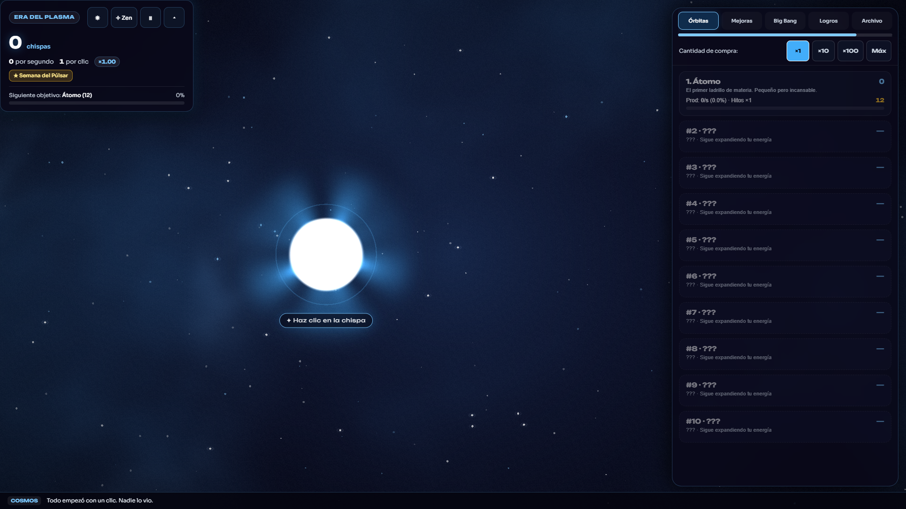
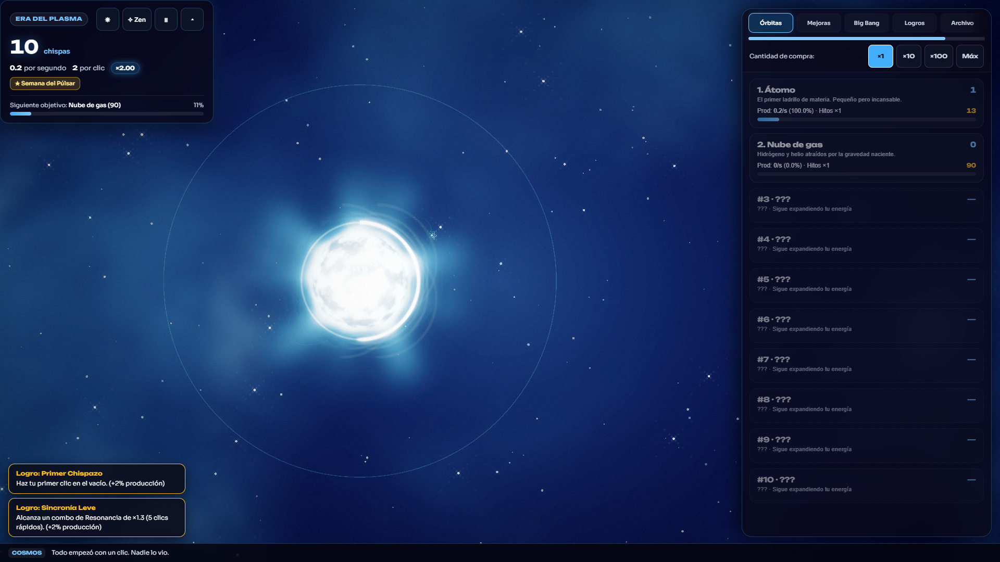
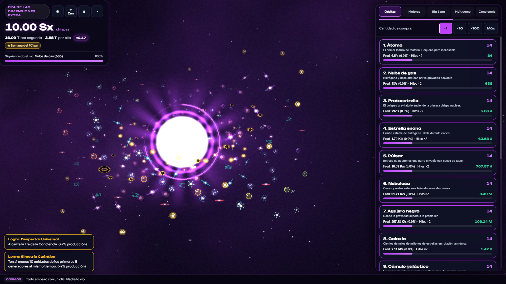
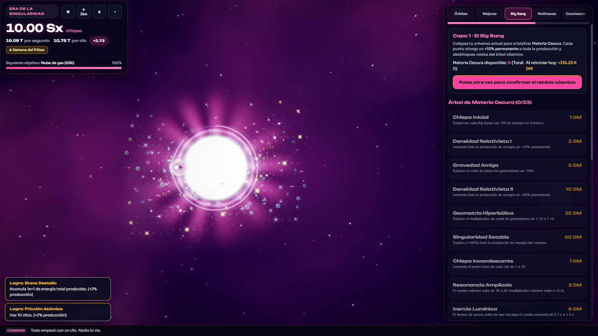
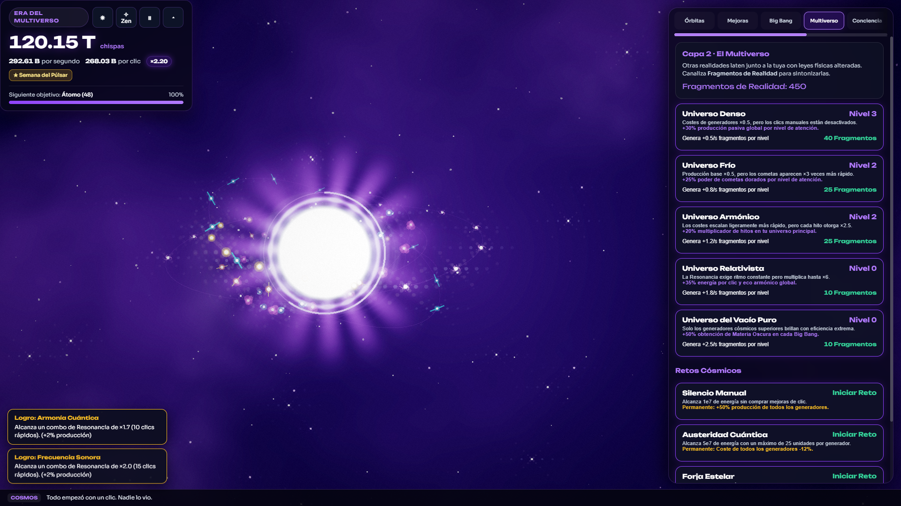
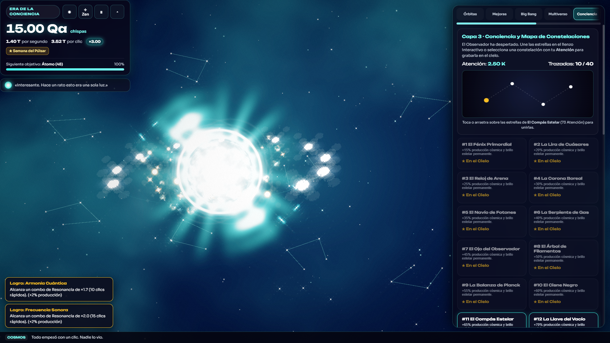
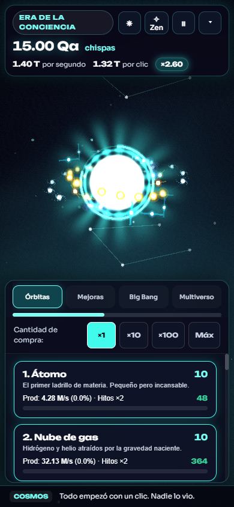

# CHISPA ∞ · Cosmos Bioluminiscente

**Un juego incremental (idle) con gráficos en tiempo real de nivel comercial y audio generativo, construido 100 % por código (cero assets externos).**

- **Demo Web en Vivo (GitHub Pages):** [https://hilton45.github.io/chispa-infinito/](https://hilton45.github.io/chispa-infinito/)
- **Repositorio Oficial:** [https://github.com/hilton45/chispa-infinito](https://github.com/hilton45/chispa-infinito)
- **Ejecutable Portable Windows (`.exe`):** Disponible en [Releases `v1.0.0`](https://github.com/hilton45/chispa-infinito/releases/tag/v1.0.0) o compilando localmente con `npm run build:exe`.

---

## 1. Visión General

En **CHISPA ∞** eres la primera chispa en el silencio del vacío. Cada clic enciende energía que inviertes en formar átomos, nubes moleculares, protoestrellas, estrellas enanas, púlsares, nebulosas, agujeros negros con lente gravitacional, galaxias espirales, cúmulos, universos, cuásares, branas, cuerdas cósmicas, burbujas de multiverso, mentes cósmicas y réplicas recursivas de la chispa original.

Todo lo que construyes **aparece en pantalla orbitando en 3D alrededor de tu chispa**, mientras el cielo evoluciona a través de **16 eras cósmicas** con transiciones de color y música ambiental generativa en WebAudio.

---

## 2. Inicio Rápido

```bash
# 1. Instalar dependencias
npm install

# 2. Iniciar servidor de desarrollo (http://localhost:3000)
npm run dev

# 3. Ejecutar suite de pruebas unitarias (Vitest)
npm test

# 4. Ejecutar el bot simulador de balance económico
npm run simulate

# 5. Compilar bundle de producción y PWA offline
npm run build
```

---

## 3. Galería Visual (100 % Código Procedural)

| Vista | Captura |
| :--- | :--- |
| **A. Inicio (Era del Plasma)** |  |
| **B. Primer Átomo y Combo de Resonancia** |  |
| **C. Las 16 Órbitas Completas (166 FPS)** |  |
| **D. Secuencia Cinemática del Big Bang** |  |
| **E. Multiverso y Retos Cósmicos** |  |
| **F. Conciencia y Mapa de Constelaciones** |  |
| **G. Diseño Responsivo Móvil (390×844)** |  |

---

## 4. Características Principales

- **Cero Assets Externos:** Ninguna imagen, sprite ni archivo `.mp3`/`.wav`. Toda la escena se genera mediante shaders GLSL personalizados en **PixiJS v8**, geometría vectorial procedural y síntesis en tiempo real con **WebAudio API**. Fuentes autohospedadas con `@fontsource/unbounded` y `@fontsource/sora`.
- **Cinco Capas de Progresión Profunda:**
  1. **Capa 0 · Energía:** 16 generadores orbitales, hitos $\times 2$ en cada escalón ($10, 25, 50 \dots 500$), 62 mejoras, combo de **Resonancia** con anillo arcoíris y **12 tipos de cometas dorados**.
  2. **Capa 1 · Big Bang:** Secuencia cinemática de implosión y renacimiento, **Materia Oscura** y árbol permanente de **23 nodos** en 5 ramas (producción, clic, cometas, autómatas cuánticos y memoria offline).
  3. **Capa 2 · Multiverso:** **Fragmentos de Realidad**, 5 **Universos Paralelos** con leyes físicas alteradas y 4 **Retos Cósmicos**.
  4. **Capa 3 · Conciencia:** Moneda **Atención**, **Mapa de 40 Constelaciones** que quedan grabadas en el cielo y **El Observador**, una mascota luminosa que comenta tu viaje.
  5. **Capa 4 · Eternidad:** Moneda **Eones**, **Reloj Cósmico** (acelerar $\times 2$, rebobinar ejecuciones) y **Nueva Partida+** («Reescribir la Primera Chispa») sin tope duro.
- **Contenido y Pulido:**
  - **160 Logros** (+2% de producción cada uno), incluidos 18 logros secretos y aspectos desbloqueables (*skins* con shader propio) para el núcleo.
  - **105 Noticias del Ticker** con humor cósmico cálido y seco.
  - **Enciclopedia Astronómica Real:** 16 fichas educativas con datos astrofísicos verificados (masas solares, radios de Schwarzschild, temperaturas en Kelvin).
  - **Modo Zen** contemplativo, racha diaria sin castigos, guardado versionado con backup rotativo y exportación/importación Base64 con suma de verificación (*checksum* FNV-1a).

---

## 4. Arquitectura del Proyecto

```
src/
  core/    Simulación pura desacoplada (20 Hz): GameState, Economy (Decimal), Simulation
  data/    Datos de balance: generators (1-16), upgrades, achievements (160), eras (16), news (105), comets (12), darkMatterTree (23), extendedLayers
  render/  Escena PixiJS v8: SkyLayer (shader fbm), OrbitsLayer (3D elíptico), SparkCore (shader), EffectsLayer (pooling 3000 partículas), PostProcess (bloom + lente gravitacional), QualityGovernor
  ui/      Interfaz DOM accesible (WCAG AA), pestañas, modales, atajos de teclado y Modo Zen
  audio/   Sintetizador procedural WebAudio (escala pentatónica, acordes y música generativa por era)
  save/    Serialización versionada, migración automática, backup rotativo y export/import con checksum
  i18n/    Español neutro e inglés integrado
scripts/
  simulate.ts  Bot de simulación económica que valida los tiempos de las metas de ritmo
tests/
  unit/    Suites Vitest para economía, simulación, capas 2-5 y persistencia
  e2e/     Suite E2E (Playwright) y captura automatizada de las vistas A–G
```

---

## 6. Cómo Ajustar el Balance

Todos los parámetros numéricos viven desacoplados en `src/data/`:
1. Edita costes o producciones base en [`src/data/generators.ts`](./src/data/generators.ts) o mejoras en [`src/data/upgrades.ts`](./src/data/upgrades.ts).
2. Ejecuta `npm run simulate` para que el bot juegue una partida acelerada con estrategia de mejor retorno (ROI) e imprima los tiempos exactos de cada hito.
3. Consulta [`docs/BALANCE.md`](./docs/BALANCE.md) para las fórmulas cerradas y [`docs/DECISIONES.md`](./docs/DECISIONES.md) para el registro arquitectónico.

---

## 7. Cómo Subirlo a GitHub y Desplegar en GitHub Pages

El proyecto ya tiene Git inicializado en la rama `main` con la etiqueta `v1.0.0` y el flujo de trabajo en [`.github/workflows/deploy.yml`](./.github/workflows/deploy.yml):

```bash
# 1. Conectar al repositorio oficial en GitHub:
git remote add origin https://github.com/hilton45/chispa-infinito.git

# 2. Subir el código y la etiqueta v1.0.0:
git push -u origin main --tags
```

Para activar la demo automática en **GitHub Pages**:
1. En tu repositorio de GitHub, entra en **Settings → Pages**.
2. En **Build and deployment → Source**, elige **GitHub Actions**.
3. El workflow `CI & Deploy CHISPA ∞` compilará, ejecutará las pruebas y publicará la PWA automáticamente.

---

## 8. Licencia

Distribuido bajo la licencia **MIT**. Consulta [`LICENSE`](./LICENSE) para más detalles.
